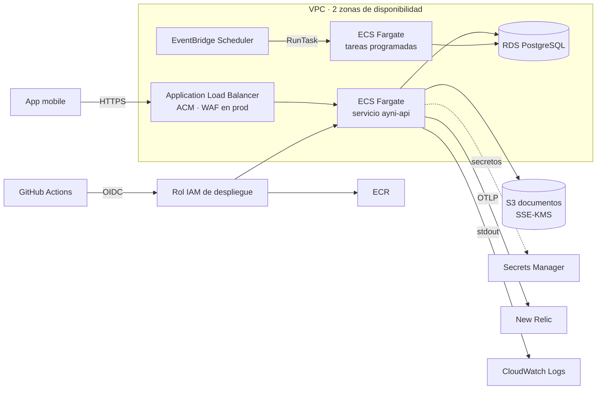
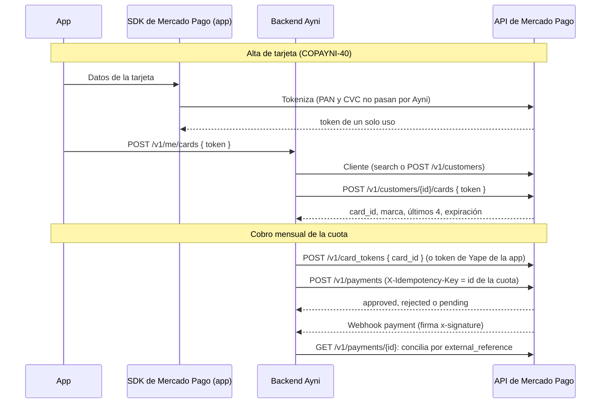

# Arquitectura de infraestructura (ADR)

**Spike:** COPAYNI-11.
**Estado:** propuesto, pendiente de la aprobación del Tech Lead.
**Fecha:** 2026-10-27.

Las decisiones marcadas **[pendiente]** necesitan una respuesta antes de provisionar prd. El resto son propuestas con su justificación: se aceptan, se cambian o se rechazan en la revisión.

**Implementación (COPAYNI-12):** [infra/terraform](../infra/terraform/README.md). dev corre contra un emulador local y prd espera la cuenta dedicada (D2).

## Contexto

Lo que ya existe en el código condiciona la infraestructura:

- **API NestJS de larga duración** ([apps/backend](../apps/backend)):
  - pool de conexiones a la base de datos (cuando exista);
  - exporters OTLP con envío por lotes, que se vacían al recibir SIGTERM (máximo 5 s);
  - `/health/live` y `/health/ready`.
- **Rate limit en memoria:** es por instancia, no compartido.
- **Salida a internet desde la API:** New Relic (OTLP) y, más adelante, proveedores de OTP, pagos, KYC y payouts (pending-scope T3 a T6).
- **Tareas programadas:** cobros mensuales de pay-in, recordatorios y cierre de ciclos de cada círculo. Tienen que ser idempotentes.
- **Datos:** transaccionales (círculos, slots, pagos, auditoría) y documentos KYC sensibles.
- **Cumplimiento sin definir:** el regulador, KYC/AML, la Ley 29733 y la retención de documentos están abiertos (pending-scope L1 a L5). La infraestructura tiene que permitir cifrado, auditoría y retención configurable sin rehacerse.

## Resumen de decisiones

| #   | Tema                        | Propuesta                                                                                                                                      |
| --- | --------------------------- | ---------------------------------------------------------------------------------------------------------------------------------------------- |
| 1   | Cómputo                     | **ECS Fargate** detrás de un Application Load Balancer                                                                                         |
| 2   | Base de datos               | **Amazon RDS for PostgreSQL** (17); Single-AZ en dev, Multi-AZ en prod                                                                         |
| 3   | Documentos KYC              | **S3** privado con cifrado SSE-KMS (clave propia), versionado y URLs prefirmadas                                                               |
| 4   | Infraestructura como código | **Terraform** con módulos propios, estado en S3 con bloqueo nativo, un stack por ambiente en `live/`                                           |
| 5   | Secretos y despliegue       | **Secrets Manager** (secretos) y SSM Parameter Store (configuración); **GitHub Actions con OIDC**                                              |
| 6   | Tareas programadas          | **EventBridge Scheduler → tarea ECS** con la misma imagen                                                                                      |
| 7   | Ambiente dev                | **Emulador floci** en Docker local; prd en AWS (ver [Ambientes](#ambientes-dev-con-emulador-y-prd-en-aws))                                     |
| D1  | Región                      | **Decidido:** `us-east-1`                                                                                                                      |
| D2  | Cuenta AWS                  | **[pendiente]** cuenta dedicada a prd: en el código es un valor `CAMBIAR` (no `mayo-prod`)                                                     |
| D3  | Dominio y TLS               | **Decidido:** `backend-ayni.solutionserj.com`, solo HTTPS. El subdominio se delega desde GoDaddy a Route 53                                    |
| 8   | Observabilidad              | **New Relic como lugar principal** (APM por OTLP, métricas y logs de AWS, alertas, SLO, monitor sintético); CloudWatch de respaldo             |
| 9   | Auditoría                   | **CloudTrail** multi-región con data events de los documentos KYC y alarmas de seguridad (CIS)                                                 |
| 10  | Pasarela de pago            | **Decidido: Mercado Pago** (Checkout API, Perú), con tarjetas guardadas y **Yape** (ver [Pasarela de pago](#10-pasarela-de-pago-mercado-pago)) |

## Diagrama



## 1. Cómputo: ECS Fargate

**Opciones**

| Criterio                      | Lambda + API Gateway (adaptador NestJS)                                                                           | ECS Fargate + ALB                                              |
| ----------------------------- | ----------------------------------------------------------------------------------------------------------------- | -------------------------------------------------------------- |
| Arranque en frío              | Sí: NestJS, la validación de entorno y OpenTelemetry suman al arranque de cada instancia nueva.                   | No: las tareas quedan en ejecución.                            |
| Conexiones a la base de datos | Cada invocación concurrente abre las suyas; en la práctica exige RDS Proxy.                                       | Pool por tarea, acotado.                                       |
| Telemetría                    | Los envíos por lotes se cortan al congelarse la instancia: hay que vaciar en cada invocación o usar la capa ADOT. | Funciona como está: envío por lotes y vaciado en SIGTERM.      |
| Salida a internet             | Dentro de la VPC (para llegar a RDS) necesita NAT gateway.                                                        | Igual en prod; en dev puede usar IP pública sin NAT (ver Red). |
| Tareas programadas            | Buen encaje (EventBridge → Lambda), con un máximo de 15 min por ejecución.                                        | EventBridge Scheduler → tarea ECS, sin límite de duración.     |
| Costo con poco tráfico        | Bajo en cómputo, pero NAT y RDS Proxy son fijos (ver Costos).                                                     | Fijo: ALB y al menos una tarea.                                |
| Cambios en el código          | Adaptador serverless, `main` distinto y vaciado de telemetría por invocación.                                     | Ninguno: imagen de contenedor con `node dist/main.js`.         |

**Propuesta:** ECS Fargate. Con la API dentro de una VPC, Lambda no sale más barata (NAT gateway más RDS Proxy) y obliga a adaptar el arranque, la telemetría y las conexiones. Fargate ejecuta la misma imagen en todos los ambientes y en las tareas programadas.

**Consecuencias**

- La imagen se publica en ECR y el despliegue actualiza el servicio ECS. Activar el _deployment circuit breaker_ con rollback automático es la estrategia de rollback que pide COPAYNI-12.
- **Health checks:**
  - El ALB comprueba `/health/live`. Si comprobara `/health/ready`, una caída de la base de datos marcaría todas las tareas como no saludables y ECS las reemplazaría en bucle sin resolver nada.
  - `/health/ready` lo usan el smoke test posterior al despliegue y una alarma.
- **Apagado:** el `stopTimeout` de ECS (30 s por defecto) y el `deregistration_delay` del ALB (bajarlo a unos 15 s) dejan margen para terminar las peticiones y vaciar la telemetría.
- **Rate limit:** con dos o más tareas, el limitador en memoria es por tarea. En prod se agrega una regla de AWS WAF por IP en el ALB, y el de la app queda como segunda capa. Los límites que tienen que ser exactos (intentos de OTP) van en la base de datos, no en memoria.
- **Arquitectura x86 al inicio.** Graviton (ARM) es más barato, pero exige construir la imagen para arm64 en CI; se puede evaluar después.

## 2. Base de datos: RDS for PostgreSQL

**Opciones:** RDS for PostgreSQL, Aurora PostgreSQL (provisionado o Serverless v2) y DynamoDB.

**Propuesta:** RDS for PostgreSQL 17.

- **Relacional:** el dominio necesita transacciones ACID y bloqueos de fila. Dos usuarios no pueden reservar el mismo slot (COPAYNI-24) y los pagos, las cuotas y la auditoría tienen que ser consistentes. Por eso DynamoDB queda descartada.
- **RDS en lugar de Aurora:** RDS es más barato con este volumen. Aurora conviene más adelante si se necesitan réplicas con failover rápido o escalado automático de lectura. La migración es posible con un snapshot.
- **Por ambiente:**
  - dev: `db.t4g.micro` Single-AZ, 20 GB gp3, backups de 7 días;
  - prod: `db.t4g.small` o mayor, **Multi-AZ**, backups de 30 días, protección contra borrado, Performance Insights.
- **Siempre:**
  - cifrado en reposo con KMS;
  - TLS obligatorio (`rds.force_ssl = 1`);
  - en subredes privadas, accesible solo desde el security group de la API y de las tareas.
- **Credenciales:**
  - La contraseña maestra la gestiona RDS en Secrets Manager (`manage_master_user_password`), así que nunca pasa por el estado de Terraform.
  - La API usa un usuario propio con permisos mínimos, creado por las migraciones.
- **Migraciones:** se ejecutan como tarea ECS de una sola vez en el pipeline, antes de actualizar el servicio. Si fallan, no se despliega.

**Decisión siguiente, fuera de este spike:** la librería de acceso a datos y migraciones (COPAYNI-24). Tiene que permitir transacciones explícitas y `SELECT … FOR UPDATE`, y queda detrás de los puertos de repositorio.

## 3. Documentos KYC: S3 con SSE-KMS

- **Acceso:** un bucket por ambiente, con _Block Public Access_ completo, propietario forzado (sin ACL) y política que rechaza todo lo que no sea TLS.
- **Cifrado:** SSE-KMS con una clave propia del bucket. Solo el rol de la tarea puede usarla.
- **Auditoría de accesos:** el trail registra los **data events** del bucket (cada lectura y escritura de un documento) además de los usos de la clave. Los data events se activan explícitamente; sin ellos, CloudTrail solo registra la gestión del bucket (ver Observabilidad y auditoría).
- **Versionado** activo para recuperar borrados accidentales. Las reglas de ciclo de vida para la retención esperan la decisión de Legal (L5).
- **Subida y descarga** con URLs prefirmadas de vida corta, generadas por la API después de autorizar al usuario (COPAYNI-43). El archivo no pasa por la API.
- **Object Lock** (retención inmutable) solo si Legal lo exige: se activa al crear el bucket y no se puede quitar.

## 4. Terraform

Estructura de la base técnica "Terraform IaC Enterprise": módulos reutilizables (`modules/`), stacks de composición por ambiente y región (`live/<ambiente>/<región>/{account,api}/`) y `bootstrap/` por cuenta. El detalle está en [infra/terraform/README.md](../infra/terraform/README.md).

```text
infra/terraform/
  bootstrap/            una vez por cuenta, aplicado por un administrador:
                          bucket del estado (versionado, cifrado), proveedor OIDC de GitHub y roles
  modules/              network, ecr, documents-bucket, database, service-runtime (ECS + ALB),
                          api-domain (ACM + Route 53), web-acl (WAF), audit-trail (CloudTrail),
                          newrelic-aws-integration, newrelic-observability, log-forwarding,
                          observability (alarmas de respaldo de CloudWatch)
  live/
    dev/us-east-1/{account,api}/   contra el emulador local, estado local
    prd/us-east-1/{account,api}/   contra AWS, estado en S3; account se aplica primero
```

El módulo `scheduled-task` (EventBridge Scheduler) se agrega con el primer job.

- **Estado remoto:** en S3, con una clave por ambiente y bloqueo nativo (`use_lockfile = true`, Terraform 1.10 o superior). No hace falta una tabla de DynamoDB.
- **Versiones fijadas** de Terraform y del provider AWS, con `.terraform.lock.hcl` versionado.
- **Calidad:** `terraform fmt -check`, `validate`, `terraform test` (provider simulado), tflint y checkov en CI.
  - En cada PR, `terraform plan` de prd con un rol de solo lectura.
  - El `apply` de prd exige aprobación manual (GitHub Environments) y aplica el plan aprobado.
  - dev no se despliega desde CI: vive en la máquina de cada desarrollador.
- **Etiquetas comunes:** `Owner`, `Application`, `Environment`, `CostCenter`, `DataClassification`, `ManagedBy` y `Repository`, para separar los costos.

## 5. Secretos y despliegue

- **Secrets Manager:**
  - la credencial de la base de datos (gestionada por RDS);
  - `NEW_RELIC_LICENSE_KEY`;
  - luego, las credenciales de los proveedores (OTP, pagos, KYC).
  - Terraform crea el secreto vacío y el valor se carga fuera de Terraform. Así nunca queda en el estado ni en el repositorio.
- **SSM Parameter Store:** la configuración no secreta (montos de unión, moneda, flags de telemetría).
- **Inyección:** la task definition pasa ambos como variables de entorno (`secrets` y `environment`). La validación de entorno de la API sigue siendo la única puerta de entrada.
- **GitHub Actions → AWS con OIDC**, sin claves de acceso permanentes:
  - un rol de **plan** (solo lectura) para los PR;
  - un rol de **despliegue** (ECR push, registrar la task definition, actualizar el servicio, `iam:PassRole` acotado), restringido a `repo:gh0st1608/fintech-ayni:environment:<ambiente>`.
- **Pipeline de despliegue (COPAYNI-12):**
  1. CI verde.
  2. Build y push de la imagen, etiquetada con el SHA.
  3. Tarea de migraciones.
  4. Actualización del servicio, con circuit breaker y rollback.
  5. Smoke test de `/health/ready`.

## 6. Tareas programadas

- **EventBridge Scheduler** lanza una tarea ECS con la misma imagen y otro comando (`node dist/jobs/<job>.js`).
- **Idempotencia:** cada ejecución registra su clave (job y periodo) en la base de datos. Así, un reintento o una ejecución duplicada no cobra dos veces.
- **Sin cron dentro de la API:** con varias tareas se ejecutaría en cada una.

| Job                                        | Comando                          | Frecuencia                      | Qué hace                                                                                                                                                                                                                                                                                                                                                                                                           |
| ------------------------------------------ | -------------------------------- | ------------------------------- | ------------------------------------------------------------------------------------------------------------------------------------------------------------------------------------------------------------------------------------------------------------------------------------------------------------------------------------------------------------------------------------------------------------------ |
| Ciclo mensual de los círculos (COPAYNI-56) | `node dist/jobs/circle-cycle.js` | Diaria, en `BUSINESS_TIME_ZONE` | Empieza los círculos, cobra las cuotas vencidas, paga el payout del mes y termina los círculos ([circles.md](api/circles.md#ciclo-mensual-copayni-56)). Bloquea cada círculo con un advisory lock de PostgreSQL y los índices únicos impiden duplicar cuotas o payouts. Lleva el registro contable del fondo de garantía y al final revisa su saldo mínimo (COPAYNI-58). Sale con código 1 si algún círculo falló. |

## Ambientes: dev con emulador y prd en AWS

**Decisión (2026-10-27):** dev corre en la máquina de cada desarrollador contra un emulador de AWS, y prd en la cuenta dedicada. No hay cuenta AWS de dev por ahora.

**Por qué no LocalStack.** En marzo de 2026 LocalStack archivó su edición Community y pasó a una imagen única que exige cuenta y token.

- Su plan gratuito (Hobby) no permite uso comercial, y Ayni es un producto comercial.
- Además, ese plan no incluye ECS, ECR, RDS, ELBv2 ni CloudFront.
- El plan Base sí los incluye, pero cuesta 39 a 45 USD por persona al mes.

**Opciones evaluadas**

| Opción           | Resultado                                                                                                                                                                           |
| ---------------- | ----------------------------------------------------------------------------------------------------------------------------------------------------------------------------------- |
| LocalStack Hobby | Descartado: no comercial y sin ECS, RDS ni ALB.                                                                                                                                     |
| LocalStack Base  | Viable y maduro, pero pago por persona. Queda como respaldo.                                                                                                                        |
| **floci** (MIT)  | **Elegido.** ECS, RDS y ECR con contenedores reales; ELBv2, ACM, WAF, Route 53, S3, KMS, Secrets Manager, IAM y CloudWatch emulados; compatible con el provider AWS 6 de Terraform. |
| MiniStack (MIT)  | Alternativa si floci falla: también ejecuta ECS y RDS reales.                                                                                                                       |
| Cuenta AWS dev   | Unos 56 USD al mes (ver Costos). No es local.                                                                                                                                       |

**Verificado con floci 2.2.0** (`terraform apply` del stack dev):

- Los mismos módulos que prd crean 55 recursos.
- La API corre como tarea ECS real: sistema de archivos de solo lectura, usuario sin privilegios y health check en verde.
- PostgreSQL 17.6 acepta la credencial del secreto que gestiona RDS.

**Límites:** son las diferencias conocidas que se listan en el README de la infraestructura (por ejemplo, el ALB no enruta a ECS y RDS no aplica los parameter groups). Esos comportamientos se verifican en prd.

**¿API Gateway y ALB a la vez?** No. La propuesta de prd es solo el **ALB**: termina TLS y le aplica WAF (con rate limit por IP). API Gateway delante del ALB (HTTP API con VPC Link) agregaría costo y latencia sin cubrir nada que falte:

- la autenticación, la validación y el rate limit de la aplicación ya están en la API;
- el rate limit por IP lo cubre WAF.

Se reconsidera si aparece una necesidad concreta, como planes de uso por cliente o autorizadores administrados. Usar un emulador en dev no cambia la arquitectura de prd. En dev no hay ni gateway ni ALB funcional, y la API se prueba directamente en su contenedor.

## Observabilidad y auditoría

**Decisión (2026-10-28):** New Relic es el lugar principal de observabilidad y alertas; CloudWatch queda de respaldo. CloudTrail cubre la auditoría.

| Pieza                   | Cómo                                                                                                                                                                                                                                                                                           |
| ----------------------- | ---------------------------------------------------------------------------------------------------------------------------------------------------------------------------------------------------------------------------------------------------------------------------------------------- |
| Aplicación              | OpenTelemetry por OTLP directo a New Relic (COPAYNI-10): trazas, métricas y logs.                                                                                                                                                                                                              |
| Métricas de AWS         | CloudWatch Metric Streams → Firehose → New Relic (casi en tiempo real). La cuenta AWS se vincula con un rol de solo lectura y external ID.                                                                                                                                                     |
| Logs de infraestructura | WAF, PostgreSQL, flow logs y CloudTrail → Firehose → New Relic. Los de la API no, porque ya llegan por OTLP.                                                                                                                                                                                   |
| Alertas                 | New Relic: errores 5xx y latencia p95 desde los spans, infraestructura, monitor sintético externo del health check, SLO de disponibilidad (99,9 %) y de latencia (99 % bajo 800 ms) en 28 días, y alerta de consumo rápido del presupuesto de error.                                           |
| Respaldo                | CloudWatch: targets no sanos y almacenamiento de la base. Avisan aunque New Relic no esté disponible.                                                                                                                                                                                          |
| Auditoría               | CloudTrail multi-región con validación de integridad, en un bucket cifrado con un año de retención, y data events de los documentos KYC. Siete alarmas de seguridad CIS: root, consola sin MFA, llamadas no autorizadas, cambios de IAM, de security groups, de claves KMS y del propio trail. |

**Secretos:**

- **License key de ingesta:** está en Secrets Manager con el formato `{"api_key": "…"}`. La leen Firehose y la API, y nunca pasa por el estado de Terraform.
- **User API key** (la usa Terraform para crear los recursos de New Relic): llega como variable efímera desde un secreto de GitHub.

**Ambientes:** dev puede usar una cuenta de New Relic propia para la telemetría y las alertas de la API. La integración de AWS solo existe en prd, porque New Relic no puede leer el emulador.

**Costo adicional estimado (prd):**

- CloudTrail: la primera copia de los eventos de gestión es gratis; los data events cuestan ~0,10 USD por 100.000.
- Metric Streams: ~0,003 USD por 1.000 actualizaciones de métricas.
- Firehose: ~0,03 USD por GB.
- New Relic: ingesta según el plan (el gratuito incluye 100 GB al mes).
- Total con el volumen inicial: unos pocos USD al mes; se revisa con el uso real.

## Red

- **VPC** en 2 zonas de disponibilidad, con subredes públicas (ALB) y privadas (RDS).
- **dev:** las tareas van en subredes públicas con IP pública, y su security group solo acepta tráfico del ALB. Así se evita el NAT gateway, que es el costo fijo más alto de un ambiente chico. RDS sigue en subred privada.
- **prod:** las tareas van en subredes privadas, con salida por NAT hacia New Relic y los proveedores. Se arranca con **un NAT compartido** (ver Riesgos). El módulo `network` admite uno por zona (`nat_gateway_mode = "per_az"`).
- **Más adelante:** VPC endpoints (S3 gratis como gateway; ECR, Secrets Manager y Logs como interface) para reducir el tráfico por NAT.

## Costos estimados

Valores mensuales aproximados, en USD, para `us-east-1` y 730 horas. Las tarifas de Fargate, ALB, NAT e IPv4 se verificaron en las páginas de AWS; las de RDS y RDS Proxy son aproximadas. Antes de aprobar, conviene contrastar el total con el [AWS Pricing Calculator](https://calculator.aws/). En `sa-east-1` los precios son más altos (ver D1).

**dev:** 0 USD, porque corre en el emulador local (ver Ambientes). La tabla siguiente queda como referencia por si se crea una cuenta de dev.

**dev en AWS (referencia)**

| Recurso                                         | Cálculo                                  | USD/mes |
| ----------------------------------------------- | ---------------------------------------- | ------- |
| Fargate: 1 tarea de 0,25 vCPU y 0,5 GB          | 0,25 × 0,04048 + 0,5 × 0,004445 por hora | ~9      |
| ALB                                             | 0,0225 por hora + LCU mínimos            | ~17     |
| IPv4 públicas: 2 del ALB y 1 de la tarea        | 3 × 0,005 por hora                       | ~11     |
| RDS `db.t4g.micro` Single-AZ + 20 GB gp3        | aproximado                               | ~14     |
| Secrets Manager, KMS, CloudWatch Logs, ECR y S3 | uso bajo                                 | ~5      |
| **Total dev**                                   |                                          | **~56** |

**Lo mismo con Lambda, como comparación:** Lambda y API Gateway cuestan casi nada con poco tráfico, pero se suman el NAT gateway (~33 más datos) y RDS Proxy (~22), y RDS es igual (~14). El total da ~70, sin ahorro frente a Fargate.

**prod inicial (alta disponibilidad)**

| Recurso                                              | USD/mes  |
| ---------------------------------------------------- | -------- |
| Fargate: 2 tareas de 0,5 vCPU y 1 GB                 | ~36      |
| ALB y 2 IPv4 públicas                                | ~25      |
| 1 NAT gateway compartido + datos (uno por zona: ~70) | ~37      |
| RDS `db.t4g.small` Multi-AZ + 50 GB gp3              | ~60      |
| AWS WAF (web ACL, unas 3 reglas, tráfico bajo)       | ~10      |
| Secrets Manager, KMS, CloudWatch, ECR, S3 y backups  | ~15      |
| **Total prod**                                       | **~182** |

**No incluido:**

- dominio y DNS (Route 53: ~0,50 por zona);
- staging, que se puede apagar fuera de horario o crear solo cuando se necesite;
- New Relic, que según su plan gratuito incluye una cuota mensual de ingesta (verificar en la cuenta);
- proveedores externos (OTP, pagos, KYC);
- crecimiento por tráfico.

**Ahorros posibles:**

- ya aplicado: un solo NAT gateway en prod (si cae esa zona, se pierde la salida a internet; pasar a uno por zona cuesta ~+33);
- Graviton (alrededor de 20 % menos en Fargate);
- Savings Plans cuando la carga se estabilice.

## Riesgos

| Riesgo                                                                                                                                                            | Mitigación                                                                                                                                                                                                                                |
| ----------------------------------------------------------------------------------------------------------------------------------------------------------------- | ----------------------------------------------------------------------------------------------------------------------------------------------------------------------------------------------------------------------------------------- |
| **El perfil AWS por defecto de la máquina de desarrollo es `mayo-prod`** (otra cuenta productiva). Un `terraform apply` sin perfil explícito actuaría sobre ella. | **Implementado:**<br>- dev usa credenciales fijas de prueba y solo admite el endpoint local.<br>- El provider de prd tiene `allowed_account_ids` con la cuenta dedicada y rechaza la de ejemplo.<br>- Despliegues solo desde CI con OIDC. |
| La región elegida no cumple lo que defina Legal sobre transferencia de datos (L3).                                                                                | Decidir D1 con Legal antes de cargar datos reales. Cambiar de región con datos es una migración.                                                                                                                                          |
| El costo fijo de prod (NAT y Multi-AZ) es alto para el volumen inicial.                                                                                           | Arrancar con un NAT y revisar a los 3 meses con datos reales de uso.                                                                                                                                                                      |
| Rate limit no compartido entre tareas.                                                                                                                            | WAF por IP en el ALB y límites críticos en la base de datos.                                                                                                                                                                              |
| Tareas programadas duplicadas o reintentadas.                                                                                                                     | Claves de idempotencia por job y periodo.                                                                                                                                                                                                 |
| Secretos en el estado de Terraform.                                                                                                                               | Contraseña gestionada por RDS; secretos creados vacíos y cargados fuera de Terraform; bucket del estado cifrado y con acceso restringido.                                                                                                 |
| El DNS de `solutionserj.com` está en GoDaddy.                                                                                                                     | Se delega solo el subdominio `backend-ayni` a Route 53, con 4 registros NS que se crean una vez en GoDaddy. Después, Terraform administra el certificado y el alias sin pasos manuales.                                                   |
| New Relic deja de recibir datos o de alertar.                                                                                                                     | Alarmas de respaldo en CloudWatch para los dos síntomas más graves.                                                                                                                                                                       |
| El emulador de dev se aleja de AWS en algunos comportamientos.                                                                                                    | Diferencias documentadas. Lo que el emulador no aplica (TLS en RDS, enrutamiento del ALB, políticas) se verifica con smoke tests en prd.                                                                                                  |

## 10. Pasarela de pago: Mercado Pago

**Decidido por el negocio (2026-10-29):** Mercado Pago, con pago por tarjeta y por **Yape** (COPAYNI-34). El backend la usa detrás de `PaymentGatewayPort` (`apps/backend/src/modules/payments`); cambiar de proveedor solo cambia el adaptador.

| Pregunta del spike                    | Respuesta con Mercado Pago                                                                                                                                                                                                                                                                              | Estado                                       |
| ------------------------------------- | ------------------------------------------------------------------------------------------------------------------------------------------------------------------------------------------------------------------------------------------------------------------------------------------------------- | -------------------------------------------- |
| Tokenización y alcance PCI            | La app tokeniza la tarjeta con el SDK de Mercado Pago (Secure Fields / Card Form); el backend recibe un token de un solo uso y guarda el cliente y la tarjeta en Mercado Pago (`/v1/customers`, `/v1/customers/{id}/cards`). El backend nunca ve el PAN ni el CVC: alcance **SAQ A**                    | Implementado (adaptador)                     |
| Cobro recurrente con tarjeta guardada | Token de la tarjeta guardada (`/v1/card_tokens` con `card_id`) y pago (`/v1/payments`) con `X-Idempotency-Key`. Cobrar **sin CVV** (débito automático mensual) es "Automatic Payments" de Mercado Pago, que **requiere aprobación de su equipo comercial**                                              | **[?]** Pedir la habilitación a Mercado Pago |
| Yape                                  | La app genera un token con el SDK, el número de celular y el **OTP de la app de Yape**; el backend paga con `payment_method_id: yape`. Cada pago pide un OTP nuevo: **Yape no permite débito automático**. Tope por pago de S/500, S/900 o S/2.000 según lo configure el usuario en Yape                | Implementado (adaptador)                     |
| 3-D Secure                            | Lo resuelve el SDK de la app al tokenizar; el backend trata un pago `pending` como no cobrado hasta que el webhook lo confirme                                                                                                                                                                          | Supuesto                                     |
| Webhooks e idempotencia               | Firma `x-signature` (HMAC-SHA256 del manifiesto `id:…;request-id:…;ts:…;` con la clave secreta de la aplicación), verificada en `isValidWebhookSignature`. Responder 200 en menos de 22 s; Mercado Pago reintenta cada 15 minutos. La cuota viaja en `external_reference` y es la clave de idempotencia | Verificación implementada; endpoint en D1    |
| Payouts                               | **No encontramos** transferencias a cuentas bancarias de Mercado Pago para Perú ("Money Out" está documentado para Brasil, Argentina y México). Los payouts necesitan otro riel (transferencia bancaria o CCI)                                                                                          | **[?]** T5 abierto                           |
| Comisiones                            | Según el contrato con Mercado Pago                                                                                                                                                                                                                                                                      | **[?]** Negocio                              |

**Consecuencias para el producto:**

- **Débito automático solo con tarjeta** y solo si Mercado Pago habilita Automatic Payments. Quien paga con Yape lo hace cada mes desde la app (el flujo de pago D1): si no paga, la cuota queda vencida y aplica la mora (COPAYNI-57).
- El tope de Yape por pago puede ser menor que una cuota grande: la app debe avisarlo antes de elegir Yape.

**Configuración:** `PAYMENT_GATEWAY` (`mercadopago` o `fake`, prohibido en production), `MERCADOPAGO_ACCESS_TOKEN` y `MERCADOPAGO_WEBHOOK_SECRET` (secretos en Secrets Manager), `MERCADOPAGO_API_URL` y `MERCADOPAGO_TIMEOUT_MS`. Sin `PAYMENT_GATEWAY`, toda operación con la pasarela falla.



Fuentes: [Yape en Checkout API](https://www.mercadopago.com.pe/developers/en/docs/checkout-api-payments/integration-configuration/yape), [webhooks](https://www.mercadopago.com.pe/developers/en/docs/your-integrations/notifications/webhooks), [cobros recurrentes con tarjeta guardada](https://www.mercadopago.com.pe/developers/en/docs/automatic-payments/recurring-charges-legacy).

## 11. Verificación de identidad (KYC)

**Estado:** pendiente de elegir proveedor (spike COPAYNI-42, pending-scope T4). El backend ya tiene los puertos y adaptadores simulados ([documents.md](api/documents.md)).

- **Puertos:** `DocumentStoragePort` (URL prefirmada y comprobación de la subida), `IdentityVerifierPort` (National ID con anverso y reverso) e `IncomeReviewerPort` (comprobante de ingresos). Cambiar de proveedor es escribir un adaptador.
- **Almacenamiento:** S3 privado con SSE-KMS por defecto del bucket y URLs prefirmadas de pocos minutos; la app sube directo y el backend solo guarda la clave (`S3DocumentStorage`, probado contra floci en las pruebas y en CI). Las URLs no firman checksum: el SDK v3 firmaría el CRC32 de un cuerpo vacío y S3 rechazaría la subida.
- **Sin proveedor en production:** `KYC_PROVIDER=manual` deja los documentos en revisión de operaciones; `simulated` está prohibido.

Propuesta de documentos obligatorios y de proveedores para Perú: [kyc-peru.md](kyc-peru.md). Criterios para el spike:

| Criterio       | Qué se evalúa                                                                    |
| -------------- | -------------------------------------------------------------------------------- |
| Cobertura      | DNI peruano (anverso y reverso), OCR y validación contra RENIEC                  |
| Prueba de vida | Selfie con liveness, si Legal o el regulador lo exigen                           |
| Integración    | SDK para Expo/React Native o API con imágenes ya subidas a S3; webhooks firmados |
| Resultado      | Aprobado, rechazado con motivo legible y revisión manual                         |
| Datos          | Región de procesamiento y retención (L3, L5); sin reutilizar las imágenes        |
| Costo          | Precio por verificación y mínimos mensuales                                      |

## Decisiones

- **D1. Región:** `us-east-1` (decidido el 2026-10-27). Queda pendiente confirmar con Legal la transferencia internacional de datos personales (L3) antes de cargar datos reales.
- **D2. Cuenta AWS [pendiente]:** cuenta dedicada a prd. En el código es un valor a cambiar (`aws_account_id`); con el valor de ejemplo, plan y apply fallan a propósito. No se debe usar `mayo-prod`.
- **D3. Dominio:** `backend-ayni.solutionserj.com` (decidido el 2026-10-27), solo por HTTPS. El DNS de `solutionserj.com` está en GoDaddy: se delega el subdominio a una zona de Route 53 (decidido el 2026-10-28). DNSSEC queda pendiente: requiere el registro DS en GoDaddy.

## Consecuencias para el backlog

- **COPAYNI-34:** pasarela decidida (Mercado Pago con Yape); adaptador, verificación de webhooks y configuración en el backend. Faltan la cuenta sandbox del equipo y pedir Automatic Payments a Mercado Pago.

- **COPAYNI-12:** implementado en `infra/terraform`. dev está verificado contra floci; prd está validado y probado con provider simulado. Falta la cuenta (D2) para el bootstrap, el primer apply y el workflow de despliegue.
- **COPAYNI-24:** la persistencia usa PostgreSQL. Las migraciones corren como tarea ECS.
- **COPAYNI-43:** bucket y clave KMS del módulo `documents-bucket`.
- **COPAYNI-9:** el despliegue por perfil de mobile (EAS) sigue pendiente. Las credenciales de firma pueden ir en Secrets Manager o en los secretos de GitHub Environments.
