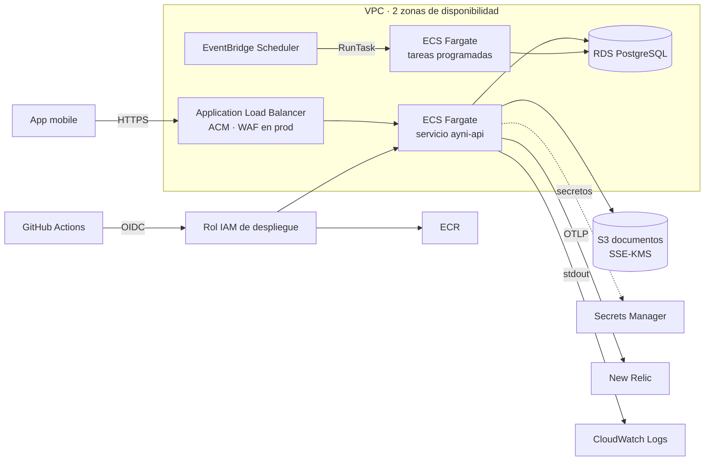

# Arquitectura de infraestructura (ADR)

**Spike:** COPAYNI-11.
**Estado:** propuesto, pendiente de la aprobación del Tech Lead.
**Fecha:** 2026-10-27.

Las decisiones marcadas **[pendiente]** necesitan una respuesta antes de provisionar (COPAYNI-12). El resto son propuestas con su justificación: se aceptan, se cambian o se rechazan en la revisión.

## Contexto

Lo que ya existe en el código condiciona la infraestructura:

- **API NestJS de larga duración** ([apps/backend](../apps/backend)):
  - pool de conexiones a la base de datos (cuando exista);
  - exporters OTLP con envío por lotes, que se vacían al recibir SIGTERM (máximo 5 s);
  - `/health/live` y `/health/ready`.
- **Rate limit en memoria:** es por instancia, no compartido.
- **Salida a internet desde la API:** New Relic (OTLP) y, más adelante, proveedores de OTP, pagos, KYC y payouts (pending-scope T3 a T6).
- **Tareas programadas:** cobros mensuales de pay-in, recordatorios y cierre de ciclos de cada círculo. Tienen que ser idempotentes.
- **Datos:** transaccionales (círculos, slots, pagos, auditoría) y documentos KYC sensibles.
- **Cumplimiento sin definir:** el regulador, KYC/AML, la Ley 29733 y la retención de documentos están abiertos (pending-scope L1 a L5). La infraestructura tiene que permitir cifrado, auditoría y retención configurable sin rehacerse.

## Resumen de decisiones

| #   | Tema                     | Propuesta                                                                                    |
| --- | ------------------------ | -------------------------------------------------------------------------------------------- |
| 1   | Cómputo                  | **ECS Fargate** detrás de un Application Load Balancer                                       |
| 2   | Base de datos            | **Amazon RDS for PostgreSQL** (17); Single-AZ en dev, Multi-AZ en prod                       |
| 3   | Documentos KYC           | **S3** privado con cifrado SSE-KMS (clave propia), versionado y URLs prefirmadas             |
| 4   | Infraestructura como código | **Terraform** con módulos propios, estado en S3 con bloqueo nativo, un directorio por ambiente |
| 5   | Secretos y despliegue    | **Secrets Manager** (secretos) y SSM Parameter Store (configuración); **GitHub Actions con OIDC** |
| 6   | Tareas programadas       | **EventBridge Scheduler → tarea ECS** con la misma imagen                                    |
| D1  | Región                   | **[pendiente]** `us-east-1` o `sa-east-1`                                                    |
| D2  | Cuentas AWS              | **[pendiente]** cuenta dedicada al proyecto; idealmente una para prod y otra para dev/staging |
| D3  | Dominio y TLS            | **[pendiente]** dominio para la API (certificado ACM)                                        |

## Diagrama



## 1. Cómputo: ECS Fargate

**Opciones**

| Criterio                         | Lambda + API Gateway (adaptador NestJS)                                                         | ECS Fargate + ALB                                                    |
| -------------------------------- | ----------------------------------------------------------------------------------------------- | -------------------------------------------------------------------- |
| Arranque en frío                 | Sí: NestJS, la validación de entorno y OpenTelemetry suman al arranque de cada instancia nueva. | No: las tareas quedan en ejecución.                                  |
| Conexiones a la base de datos    | Cada invocación concurrente abre las suyas; en la práctica exige RDS Proxy.                     | Pool por tarea, acotado.                                             |
| Telemetría                       | Los envíos por lotes se cortan al congelarse la instancia: hay que vaciar en cada invocación o usar la capa ADOT. | Funciona como está: envío por lotes y vaciado en SIGTERM.            |
| Salida a internet                | Dentro de la VPC (para llegar a RDS) necesita NAT gateway.                                       | Igual en prod; en dev puede usar IP pública sin NAT (ver Red).      |
| Tareas programadas               | Buen encaje (EventBridge → Lambda), con un máximo de 15 min por ejecución.                       | EventBridge Scheduler → tarea ECS, sin límite de duración.           |
| Costo con poco tráfico           | Bajo en cómputo, pero NAT y RDS Proxy son fijos (ver Costos).                                    | Fijo: ALB y al menos una tarea.                                      |
| Cambios en el código             | Adaptador serverless, `main` distinto y vaciado de telemetría por invocación.                    | Ninguno: imagen de contenedor con `node dist/main.js`.               |

**Propuesta:** ECS Fargate. Con la API dentro de una VPC, Lambda no sale más barata (NAT gateway más RDS Proxy) y obliga a adaptar el arranque, la telemetría y las conexiones. Fargate ejecuta la misma imagen en todos los ambientes y en las tareas programadas.

**Consecuencias**

- La imagen se publica en ECR y el despliegue actualiza el servicio ECS. Activar el _deployment circuit breaker_ con rollback automático es la estrategia de rollback que pide COPAYNI-12.
- **Health checks:**
  - El ALB comprueba `/health/live`. Si comprobara `/health/ready`, una caída de la base de datos marcaría todas las tareas como no saludables y ECS las reemplazaría en bucle sin resolver nada.
  - `/health/ready` lo usan el smoke test posterior al despliegue y una alarma.
- **Apagado:** el `stopTimeout` de ECS (30 s por defecto) y el `deregistration_delay` del ALB (bajarlo a unos 15 s) dejan margen para terminar las peticiones y vaciar la telemetría.
- **Rate limit:** con dos o más tareas, el limitador en memoria es por tarea. En prod se agrega una regla de AWS WAF por IP en el ALB, y el de la app queda como segunda capa. Los límites que tienen que ser exactos (intentos de OTP) van en la base de datos, no en memoria.
- **Arquitectura x86 al inicio.** Graviton (ARM) es más barato, pero exige construir la imagen para arm64 en CI; se puede evaluar después.

## 2. Base de datos: RDS for PostgreSQL

**Opciones:** RDS for PostgreSQL, Aurora PostgreSQL (provisionado o Serverless v2) y DynamoDB.

**Propuesta:** RDS for PostgreSQL 17.

- **Relacional:** el dominio necesita transacciones ACID y bloqueos de fila. Dos usuarios no pueden reservar el mismo slot (COPAYNI-24) y los pagos, las cuotas y la auditoría tienen que ser consistentes. Por eso DynamoDB queda descartada.
- **RDS en lugar de Aurora:** RDS es más barato con este volumen. Aurora conviene más adelante si se necesitan réplicas con failover rápido o escalado automático de lectura. La migración es posible con un snapshot.
- **Por ambiente:**
  - dev: `db.t4g.micro` Single-AZ, 20 GB gp3, backups de 7 días;
  - prod: `db.t4g.small` o mayor, **Multi-AZ**, backups de 30 días, protección contra borrado, Performance Insights.
- **Siempre:**
  - cifrado en reposo con KMS;
  - TLS obligatorio (`rds.force_ssl = 1`);
  - en subredes privadas, accesible solo desde el security group de la API y de las tareas.
- **Credenciales:**
  - La contraseña maestra la gestiona RDS en Secrets Manager (`manage_master_user_password`), así que nunca pasa por el estado de Terraform.
  - La API usa un usuario propio con permisos mínimos, creado por las migraciones.
- **Migraciones:** se ejecutan como tarea ECS de una sola vez en el pipeline, antes de actualizar el servicio. Si fallan, no se despliega.

**Decisión siguiente, fuera de este spike:** la librería de acceso a datos y migraciones (COPAYNI-24). Tiene que permitir transacciones explícitas y `SELECT … FOR UPDATE`, y queda detrás de los puertos de repositorio.

## 3. Documentos KYC: S3 con SSE-KMS

- **Acceso:** un bucket por ambiente, con _Block Public Access_ completo, propietario forzado (sin ACL) y política que rechaza todo lo que no sea TLS.
- **Cifrado:** SSE-KMS con una clave propia del bucket. Solo el rol de la tarea puede usarla, y cada acceso queda en CloudTrail.
- **Versionado** activo para recuperar borrados accidentales. Las reglas de ciclo de vida para la retención esperan la decisión de Legal (L5).
- **Subida y descarga** con URLs prefirmadas de vida corta, generadas por la API después de autorizar al usuario (COPAYNI-43). El archivo no pasa por la API.
- **Object Lock** (retención inmutable) solo si Legal lo exige: se activa al crear el bucket y no se puede quitar.

## 4. Terraform

```text
infra/terraform/
  bootstrap/            una vez por cuenta, aplicado por un administrador:
                          bucket del estado (versionado, cifrado), proveedor OIDC de GitHub y roles
  modules/
    network/            VPC, subredes públicas y privadas en 2 AZ, NAT opcional
    ecr/                repositorio de imágenes, escaneo al publicar, retención de imágenes
    ecs-service/        cluster, servicio, task definition, ALB, target group, logs
    database/           RDS PostgreSQL, subnet group, parameter group, security group
    documents-bucket/   S3 + clave KMS + políticas
    scheduled-task/     EventBridge Scheduler → RunTask
  envs/
    dev/  staging/  prod/   main.tf (instancia los módulos), backend.tf, terraform.tfvars sin secretos
```

- **Estado remoto:** en S3, con una clave por ambiente y bloqueo nativo (`use_lockfile = true`, Terraform 1.10 o superior). No hace falta una tabla de DynamoDB.
- **Versiones fijadas** de Terraform y del provider AWS, con `.terraform.lock.hcl` versionado.
- **Calidad:** `terraform fmt -check`, `terraform validate` y `tflint` en CI.
  - En cada PR, `terraform plan` con un rol de solo lectura.
  - El `apply` de dev corre al hacer merge a `main`.
  - El de prod exige aprobación manual (GitHub Environments).
- **Etiquetas comunes:** `project`, `environment`, `managed-by=terraform`, para separar los costos.

## 5. Secretos y despliegue

- **Secrets Manager:**
  - la credencial de la base de datos (gestionada por RDS);
  - `NEW_RELIC_LICENSE_KEY`;
  - luego, las credenciales de los proveedores (OTP, pagos, KYC).
  - Terraform crea el secreto vacío y el valor se carga fuera de Terraform. Así nunca queda en el estado ni en el repositorio.
- **SSM Parameter Store:** la configuración no secreta (montos de unión, moneda, flags de telemetría).
- **Inyección:** la task definition pasa ambos como variables de entorno (`secrets` y `environment`). La validación de entorno de la API sigue siendo la única puerta de entrada.
- **GitHub Actions → AWS con OIDC**, sin claves de acceso permanentes:
  - un rol de **plan** (solo lectura) para los PR;
  - un rol de **despliegue** (ECR push, registrar la task definition, actualizar el servicio, `iam:PassRole` acotado), restringido a `repo:gh0st1608/fintech-ayni:environment:<ambiente>`.
- **Pipeline de despliegue (COPAYNI-12):**
  1. CI verde.
  2. Build y push de la imagen, etiquetada con el SHA.
  3. Tarea de migraciones.
  4. Actualización del servicio, con circuit breaker y rollback.
  5. Smoke test de `/health/ready`.

## 6. Tareas programadas

- **EventBridge Scheduler** lanza una tarea ECS con la misma imagen y otro comando (`node dist/jobs/<job>.js`).
- **Idempotencia:** cada ejecución registra su clave (job y periodo) en la base de datos. Así, un reintento o una ejecución duplicada no cobra dos veces.
- **Sin cron dentro de la API:** con varias tareas se ejecutaría en cada una.

## Red

- **VPC** en 2 zonas de disponibilidad, con subredes públicas (ALB) y privadas (RDS).
- **dev:** las tareas van en subredes públicas con IP pública, y su security group solo acepta tráfico del ALB. Así se evita el NAT gateway, que es el costo fijo más alto de un ambiente chico. RDS sigue en subred privada.
- **prod:** las tareas van en subredes privadas, con un NAT gateway por zona para la salida a New Relic y a los proveedores.
- **Más adelante:** VPC endpoints (S3 gratis como gateway; ECR, Secrets Manager y Logs como interface) para reducir el tráfico por NAT.

## Costos estimados

Valores mensuales aproximados, en USD, para `us-east-1` y 730 horas. Las tarifas de Fargate, ALB, NAT e IPv4 se verificaron en las páginas de AWS; las de RDS y RDS Proxy son aproximadas. Antes de aprobar, conviene contrastar el total con el [AWS Pricing Calculator](https://calculator.aws/). En `sa-east-1` los precios son más altos (ver D1).

**dev (ECS Fargate, propuesta)**

| Recurso                                                          | Cálculo                                     | USD/mes  |
| ---------------------------------------------------------------- | ------------------------------------------- | -------- |
| Fargate: 1 tarea de 0,25 vCPU y 0,5 GB                           | 0,25 × 0,04048 + 0,5 × 0,004445 por hora    | ~9       |
| ALB                                                              | 0,0225 por hora + LCU mínimos               | ~17      |
| IPv4 públicas: 2 del ALB y 1 de la tarea                         | 3 × 0,005 por hora                          | ~11      |
| RDS `db.t4g.micro` Single-AZ + 20 GB gp3                         | aproximado                                  | ~14      |
| Secrets Manager, KMS, CloudWatch Logs, ECR y S3                  | uso bajo                                    | ~5       |
| **Total dev**                                                    |                                             | **~56**  |

**Lo mismo con Lambda, como comparación:** Lambda y API Gateway cuestan casi nada con poco tráfico, pero se suman el NAT gateway (~33 más datos) y RDS Proxy (~22), y RDS es igual (~14). El total da ~70, sin ahorro frente a Fargate.

**prod inicial (alta disponibilidad)**

| Recurso                                                    | USD/mes   |
| ---------------------------------------------------------- | --------- |
| Fargate: 2 tareas de 0,5 vCPU y 1 GB                       | ~36       |
| ALB y 2 IPv4 públicas                                      | ~25       |
| 2 NAT gateways (uno por zona) + datos                      | ~70       |
| RDS `db.t4g.small` Multi-AZ + 50 GB gp3                    | ~60       |
| AWS WAF (web ACL, unas 3 reglas, tráfico bajo)             | ~10       |
| Secrets Manager, KMS, CloudWatch, ECR, S3 y backups        | ~15       |
| **Total prod**                                             | **~215**  |

**No incluido:**

- dominio y DNS (Route 53: ~0,50 por zona);
- staging, que se puede apagar fuera de horario o crear solo cuando se necesite;
- New Relic, que según su plan gratuito incluye una cuota mensual de ingesta (verificar en la cuenta);
- proveedores externos (OTP, pagos, KYC);
- crecimiento por tráfico.

**Ahorros posibles:**

- un solo NAT gateway en prod (~-33; si cae esa zona, se pierde la salida a internet);
- Graviton (alrededor de 20 % menos en Fargate);
- Savings Plans cuando la carga se estabilice.

## Riesgos

| Riesgo                                                                                       | Mitigación                                                                                   |
| -------------------------------------------------------------------------------------------- | -------------------------------------------------------------------------------------------- |
| **El perfil AWS por defecto de la máquina de desarrollo es `mayo-prod`** (otra cuenta productiva). Un `terraform apply` sin perfil explícito actuaría sobre ella. | Cuenta dedicada (D2). Provider con `allowed_account_ids` por ambiente, para que Terraform se niegue a operar en otra cuenta. Despliegues solo desde CI con OIDC. |
| La región elegida no cumple lo que defina Legal sobre transferencia de datos (L3).           | Decidir D1 con Legal antes de cargar datos reales. Cambiar de región con datos es una migración. |
| El costo fijo de prod (NAT y Multi-AZ) es alto para el volumen inicial.                      | Arrancar con un NAT y revisar a los 3 meses con datos reales de uso.                          |
| Rate limit no compartido entre tareas.                                                       | WAF por IP en el ALB y límites críticos en la base de datos.                                  |
| Tareas programadas duplicadas o reintentadas.                                                | Claves de idempotencia por job y periodo.                                                    |
| Secretos en el estado de Terraform.                                                          | Contraseña gestionada por RDS; secretos creados vacíos y cargados fuera de Terraform; bucket del estado cifrado y con acceso restringido. |
| Sin dominio no hay TLS en el ALB, e iOS exige HTTPS.                                         | D3 antes de conectar la app a dev.                                                           |

## Decisiones pendientes

- **D1. Región:**
  - `us-east-1` es la más barata y tiene todos los servicios.
  - `sa-east-1` (São Paulo) está más cerca de los usuarios si el producto opera en Perú, pero es más cara.
  - Depende de Legal (L3, transferencia internacional de datos personales) y de la latencia aceptable.
- **D2. Cuenta AWS:** confirmar la cuenta (o las cuentas) del proyecto y quién administra el acceso. No se debe usar `mayo-prod`.
- **D3. Dominio de la API:** p. ej. `api.<dominio>` y `api.dev.<dominio>`, y si el DNS estará en Route 53.

## Consecuencias para el backlog

- **COPAYNI-12:** se implementa según este documento, empezando por `bootstrap/` y `envs/dev`. Requiere D1, D2 y D3.
- **COPAYNI-24:** la persistencia usa PostgreSQL. Las migraciones corren como tarea ECS.
- **COPAYNI-43:** bucket y clave KMS del módulo `documents-bucket`.
- **COPAYNI-9:** el despliegue por perfil de mobile (EAS) sigue pendiente. Las credenciales de firma pueden ir en Secrets Manager o en los secretos de GitHub Environments.
