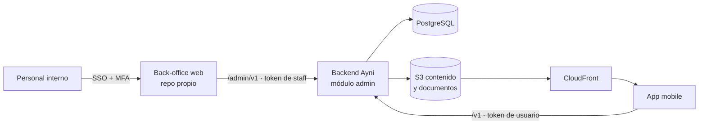

# Plan de implementación — Back-office de Ayni

Estado: **propuesta**, pendiente de aprobación del PO y del TL. Corresponde al pendiente **D13** de [pending-scope.md](pending-scope.md).

Convención: **[H]** hecho observado (Figma, código o docs), **[I]** inferencia técnica, **[?]** decisión pendiente.

## 1. Por qué un back-office

Hoy la app no tiene un lugar desde donde operarla:

- **Contenido de Home sin fuente [H].** "Latest Offers" y "Popular Goals" están en el Figma (Home `55:8637`), pero no hay quién los cree ni dónde guardarlos. Por eso COPAYNI-25 solo implementó "Recomendados para ti".
- **Reglas de negocio en variables de entorno [H].** Las reglas viven en el backend como variables (`JOIN_PAYOUT_*`, `SLOT_*_BPS`, `ADMIN_FEE_*`, `PAYOUT_METHODS*`, etc.). Cambiar una cuota o un límite exige un redeploy de ingeniería.
- **Sin roles ni personal interno [H].** No hay nadie que pueda validar KYC, revisar un pago fallido o atender a un usuario.
- **Contenido sin pantalla ni dueño [H].** Varias pantallas dependen de contenido que no está diseñado ni tiene responsable: Payment Policy, Help y FAQ (D7), Términos y Privacidad (L4), el carrusel de Payout Amount (D16) y los nombres de los planes (R12).

**Decisión recomendada:** el **contenido editorial** (ofertas, metas, banners, textos de ayuda) y la **operación** (círculos, KYC, pagos, soporte) se gestionan desde un back-office propio. No conviene usar un CMS externo, por tres razones:

1. **Contenido acoplado al dominio.** Una oferta o una meta lleva a una acción de la app, como abrir el flujo de unión con un monto o abrir un programa de ahorro. Debe validarse contra las reglas vigentes: una oferta no puede anunciar un monto que el usuario no puede elegir.
2. **Una sola autenticación y auditoría.** El back-office va a existir de todos modos para la operación, y el contenido comparte con ella la autenticación del personal, la auditoría y los permisos. Un CMS sería un segundo sistema con otra identidad y otro registro de cambios.
3. **Contenido acotado.** El volumen es bajo y estructurado (tarjetas con título, imagen y destino), no hay artículos largos.

> Alternativa a considerar solo si el PO quiere un equipo de marketing autónomo con edición rica: CMS headless (p. ej. Strapi o Contentful) **solo** para textos de ayuda/legales, con el back-office manteniendo ofertas, metas y todo lo operativo. **[?]**

## 2. Alcance: todo lo administrable

### 2.1 Contenido de la app

| Módulo                            | Qué se administra                                                                                                                                      | Consumidor en la app                   | Origen                        |
| --------------------------------- | ------------------------------------------------------------------------------------------------------------------------------------------------------ | -------------------------------------- | ----------------------------- |
| Ofertas ("Latest Offers")         | Título, descripción, imagen, destino (acción interna), vigencia, prioridad, idioma, estado                                                             | Home                                   | [H] Figma Home; COPAYNI-25    |
| Metas populares ("Popular Goals") | Nombre de la meta, imagen, monto o plan sugerido, destino (programa de ahorro / Game'ya), orden, vigencia. **Campos exactos a confirmar con el Figma** | Home                                   | [H] Figma Home; [?] campos    |
| Banners                           | Banner de invitación a amigos y futuros banners de campaña: texto, imagen, destino, vigencia, audiencia                                                | Home                                   | [H] Figma Home; depende de R7 |
| Planes de ahorro                  | Nombre por idioma, monto, duraciones, cashback por plan (cuando R6 se defina)                                                                          | Elige un servicio / Programa de ahorro | [H] R6, R12; COPAYNI-32       |
| Carrusel informativo              | Tarjetas del paso 1 (Payout Amount) y destino de "Learn More"                                                                                          | Unión, paso 1                          | [H] D16                       |
| Ayuda y FAQ                       | Preguntas, respuestas, categorías, canal de soporte                                                                                                    | Help / Get Help                        | [H] D7                        |
| Documentos legales                | Términos de Uso, Política de Privacidad, Payment Policy, versionados, con aceptación registrada por usuario                                            | Onboarding, Pagos, Unión (D2/D3)       | [H] L4, D7                    |

Reglas comunes al contenido **[I]**:

- **Ciclo de vida:** `borrador → programado → publicado → archivado`, con `startsAt`/`endsAt` en la zona `BUSINESS_TIME_ZONE`.
- **Textos por idioma:** cada texto se guarda por idioma (`es`, `en`, según M3). Si falta el texto del idioma pedido, se usa el idioma por defecto. Si tampoco existe, la pieza no se publica.
- **Destinos cerrados:** el destino es un **tipo cerrado** (`join_game_ya{payout?}`, `saving_program{planId?}`, `refer_friend`, `help_article{id}`, `external_url{url}` sobre una lista blanca de dominios). Nunca se acepta un deep link libre.
- **Validación al publicar:** un `join_game_ya` con un payout fuera de `JOIN_PAYOUT_MIN..MAX` o del salto configurado se rechaza.
- **Imágenes:** se suben a S3 privado y se sirven por CloudFront. La subida valida tipo y tamaño, y se generan variantes por densidad.
- **Secciones vacías:** una sección sin contenido vigente no llega a la app y la app la oculta. Así ya funciona Home (COPAYNI-25).

### 2.2 Parámetros de negocio (hoy en variables de entorno)

Se mueven a una tabla versionada en la base del backend, con valores por defecto tomados de la configuración actual.

| Grupo            | Parámetros actuales [H]                                                                                                                                                                                                                                     | Regla pendiente |
| ---------------- | ----------------------------------------------------------------------------------------------------------------------------------------------------------------------------------------------------------------------------------------------------------- | --------------- |
| Montos           | `JOIN_PAYOUT_MIN`, `JOIN_PAYOUT_MAX`, `JOIN_PAYOUT_STEP`, `SAVING_PROGRAM_MAX`, `DEFAULT_CURRENCY`                                                                                                                                                          | M1, M6, R15     |
| Círculos         | `CIRCLE_DURATION_OPTIONS`, `CIRCLE_ASSIGNMENT_STRATEGY`, `CIRCLE_START_OFFSET_MONTHS`, `RECOMMENDED_CIRCLES_LIMIT`                                                                                                                                          | R2              |
| Precio de slots  | `SLOT_FASTEST_SHARE_BPS`, `SLOT_HIGHEST_SHARE_BPS`, `SLOT_MAX_FEE_BPS`, `SLOT_MAX_DISCOUNT_BPS`                                                                                                                                                             | R1              |
| Admin Fees       | `ADMIN_FEE_BPS`, `ADMIN_FEE_MODE`                                                                                                                                                                                                                           | R4              |
| Métodos de cobro | `PAYOUT_METHODS`, `PAYOUT_METHODS_UNAVAILABLE`, `PAYOUT_METHODS_NO_CHARGE`, `PAYOUT_PREPAID_CARD_LIMIT`                                                                                                                                                     | T5, R8          |
| Elegibilidad     | `JOIN_IDENTITY_CHECK`, `JOIN_MONTHLY_PAYIN_LIMIT`                                                                                                                                                                                                           | R5, R11         |
| Referidos        | Monto del descuento, tope de invitaciones, expiración del saldo (no existen aún)                                                                                                                                                                            | R7              |
| Cashback         | Porcentaje por plan y duración (no existe aún)                                                                                                                                                                                                              | R6              |
| Mora e impago    | Días de gracia (3 corridos), reintentos del débito automático, cargo por mora (propuesto 3 %), penalidad de devolución al expulsado (5 %), ventana de reemplazo del turno (no existen aún; valores iniciales en pending-scope §3.1)                         | R3, R17         |
| Riesgo           | Regla de confianza por tipo de turno, retención del payout (propuesto 2 cuotas base en la primera mitad), aporte al fondo de garantía (propuesto 25 % de las Admin Fees), saldo mínimo del fondo (en el backend como variables de entorno desde COPAYNI-58) | R16, R18        |

**Fuera del back-office (se quedan en entorno / Secrets Manager):** base de datos, JWT, CORS, rate limit, telemetría y la **política de OTP** (`OTP_*`). Son parámetros de seguridad o infraestructura: cambiarlos desde una UI amplía la superficie de ataque y su cambio debe pasar por el pipeline. **[I]**

Reglas de los parámetros **[I]**:

- **Versiones con vigencia:** cada cambio crea una versión nueva con `effectiveFrom`, autor, motivo y aprobador. No se sobrescribe la versión anterior.
- **Doble aprobación (4-eyes)** para los parámetros financieros (precio, fees, límites, cashback, referidos, mora y riesgo). Quien propone no puede aprobar.
- **Sin efecto retroactivo:** un cambio de precio no altera círculos ya formados. Las condiciones se congelan al unirse: el precio del slot se guarda con la membresía (COPAYNI-55).
- **Validación cruzada:** se aplican las mismas validaciones que hoy hace `env.validation.ts` (p. ej. `min ≤ max`, el salto divide el rango, las duraciones son positivas). Además, el back-office muestra una **vista previa** del efecto, como la tabla de cuotas por slot para un payout de ejemplo.
- **Lectura en el backend:** el backend lee los parámetros con una caché corta e invalidación al publicar. Si la tabla no está disponible, usa la última versión conocida y nunca valores por defecto silenciosos.

### 2.3 Operación

| Módulo             | Funciones                                                                                                                                                                                                                                                                                                                                                                                                            | Depende de          |
| ------------------ | -------------------------------------------------------------------------------------------------------------------------------------------------------------------------------------------------------------------------------------------------------------------------------------------------------------------------------------------------------------------------------------------------------------------- | ------------------- |
| Círculos           | Listar y filtrar por estado, plazo y llenado; ver el detalle con miembros, slots y calendario; crear círculos a mano (si R2 lo permite); cancelar o reprogramar un círculo que no se llena; ver el estado del ciclo mensual (workflow ROSCA); **pausar y reanudar** con motivo (solo `super_admin`); reasignar el turno de un expulsado                                                                              | R2, R17, D8         |
| KYC y documentos   | Cola de revisión (National ID, Proof of Income, etc.); ver el documento con acceso auditado; aprobar o rechazar con motivo; vigencia; ajuste del límite mensual de pay-in                                                                                                                                                                                                                                            | R5, R11, T4, L2, L5 |
| Pagos y cobros     | Pay-ins y payouts por estado; pagos fallidos; conciliación con la pasarela; reintentos idempotentes                                                                                                                                                                                                                                                                                                                  | D1, T3              |
| Mora y riesgo      | Miembros en gracia y expulsados; deuda vencida más cargo por mora; desbloqueo automático al pagar (manual solo con 4-eyes); devoluciones a expulsados con penalidad; retenciones de payout liberadas y pendientes; saldo y movimientos del fondo de garantía (registro contable de COPAYNI-58; el capital semilla y las correcciones entran por `RecordFundMovementUseCase`, con motivo y 4-eyes); casos en cobranza | R3, R16, R18, D3    |
| Usuarios y soporte | Buscar por email o teléfono (con PII enmascarada); ver perfil, círculos, documentos y pagos; bloquear o desbloquear; revocar sesiones; notas de soporte                                                                                                                                                                                                                                                              | L3                  |
| Referidos          | Ver invitaciones, saldo ganado, canjeado y disponible; ajustes manuales con motivo; señales de fraude (autoreferidos, mismo dispositivo)                                                                                                                                                                                                                                                                             | R7, H7.1–H7.3       |
| Notificaciones     | Plantillas por tipo e idioma (cuota por vencer, turno de cobro, documento aprobado); envíos de campaña a segmentos                                                                                                                                                                                                                                                                                                   | D6, T7              |
| Catálogos          | Métodos de cobro (disponible o no, sin cobro, límites); idiomas habilitados; monedas (cuando M2 lo permita)                                                                                                                                                                                                                                                                                                          | T5, M2, M3          |
| Reportes           | Círculos formados y llenado, morosidad, KYC pendiente por antigüedad, conversión de ofertas (clics en el destino). Exportación a CSV **sin** PII salvo con permiso                                                                                                                                                                                                                                                   | —                   |

### 2.4 Gestión del personal y auditoría

- **Usuarios internos separados** de los usuarios de la app, con otro emisor de tokens y otra audiencia.
- **Roles propuestos [?]:**

  | Rol                 | Alcance                                                                                                         |
  | ------------------- | --------------------------------------------------------------------------------------------------------------- |
  | `content_editor`    | Contenido                                                                                                       |
  | `content_publisher` | Publicar contenido                                                                                              |
  | `ops_circles`       | Operación de círculos                                                                                           |
  | `kyc_reviewer`      | Revisión de KYC                                                                                                 |
  | `finance`           | Pagos, conciliación y parámetros financieros (proponer o aprobar)                                               |
  | `support`           | Usuarios, solo lectura y bloqueo                                                                                |
  | `admin`             | Gestión del personal, sin acceso a operar                                                                       |
  | `super_admin`       | **Admin general (decidido por el PO):** único rol que pausa y reanuda círculos; tiene los accesos privilegiados |

- **Accesos privilegiados del `super_admin` [I]:**
  - **Autenticación reforzada:** MFA resistente a phishing (passkey o llave FIDO2) y una nueva autenticación antes de cada acción crítica (pausar, reanudar, desbloquear a mano, revelar PII).
  - **Motivo y auditoría:** cada acción crítica pide un motivo obligatorio, queda en la auditoría y avisa a los demás `super_admin`.
  - **Al menos 2 personas** con el rol, para no depender de una sola cuenta. Su asignación la hace el proveedor de identidad, no el propio back-office.
  - **Sigue sujeto a 4-eyes:** el `super_admin` no puede aprobar un parámetro financiero que él mismo propuso.

- **Auditoría inmutable** de cada lectura de PII o documento y de cada escritura. Se registra actor, acción, entidad, antes y después, IP y `requestId`. Se guarda en una tabla de solo inserción y se exporta a CloudWatch.

## 3. Arquitectura propuesta

**Decisiones:**

1. **Front del back-office en un repositorio aparte (lo pedido).**
   - Aplicación web SPA en TypeScript.
   - Propuesta: React con Vite, TanStack Query (lo mismo que mobile) y una librería de componentes de administración (p. ej. MUI o Ant Design). **[?]** Aprobación del TL.
   - Se publica como estático en S3 y CloudFront, con un dominio propio (`backoffice.<dominio>`), WAF y una lista de IPs o VPN. **[?]**
2. **API de administración dentro del backend actual, no en un servicio aparte. [I]**
   - Las reglas (precio de slots, asignación, elegibilidad) ya viven allí. Duplicarlas en otro servicio llevaría a divergencias.
   - Se agrega un módulo `admin` con controladores bajo `/admin/v1`, que reutilizan los casos de uso y puertos existentes con la arquitectura hexagonal actual.
   - Es trabajo **en este repositorio**, aunque no se implementa ahora.
3. **Contratos compartidos.**
   - El backend publica OpenAPI (Swagger ya existe con `ENABLE_SWAGGER`).
   - El back-office genera su cliente tipado desde ese documento en CI. Si el contrato cambia y el cliente no compila, el build falla.
4. **Identidad del personal: proveedor OIDC corporativo con MFA obligatorio. [?]**
   - Opciones: Amazon Cognito (encaja con AWS, T1), Microsoft Entra ID o Google Workspace, según lo que use la organización.
   - El backend valida el token de staff con otra audiencia y otras claves que el de la app.
   - Las sesiones son cortas y se cierran por inactividad.
5. **API pública de contenido para la app.**
   - `GET /v1/home/content` (o un endpoint por sección) devuelve solo lo vigente, en el idioma pedido (`Accept-Language`), con `ETag` y `Cache-Control` corto.
   - La app ya oculta las secciones vacías.
6. **Exposición separada.**
   - Opción A: las rutas `/admin/*` no se publican en el ALB público; van por un listener o ALB interno.
   - Opción B: van por el mismo ALB, con una regla de WAF que las restringe al origen del back-office. Recomendación: A. **[?]**

### Modelo de datos inicial [I]

| Tabla                  | Campos clave                                                                                                                                                                      |
| ---------------------- | --------------------------------------------------------------------------------------------------------------------------------------------------------------------------------- |
| `content_items`        | `id`, `kind` (offer/goal/banner/carousel), `status`, `priority`, `starts_at`, `ends_at`, `target` (jsonb validado por tipo), `image_key`, `created_by`, `published_by`, `version` |
| `content_translations` | `content_item_id`, `locale`, `title`, `body`, `cta_label`                                                                                                                         |
| `business_parameters`  | `key`, `value` (jsonb), `effective_from`, `version`, `proposed_by`, `approved_by`, `reason`                                                                                       |
| `legal_documents`      | `kind`, `locale`, `version`, `body`, `published_at`; `user_legal_acceptances(user_id, document_id, accepted_at)`                                                                  |
| `help_articles`        | `category`, `locale`, `question`, `answer`, `order`, `status`                                                                                                                     |
| `staff_audit_log`      | `actor_id`, `action`, `entity`, `entity_id`, `before`, `after`, `ip`, `request_id`, `at` (solo inserción)                                                                         |

Los usuarios del personal y sus roles viven en el proveedor de identidad (grupos o claims). El backend no guarda contraseñas del personal.

## 4. Seguridad y cumplimiento

- **Privilegio mínimo por rol.** Los endpoints sensibles exigen el permiso explícito. Ningún rol borra datos financieros: solo hay anulaciones con un registro compensatorio.
- **PII enmascarada por defecto** (teléfono, email, documento). Para ver el dato completo hay que pedir "revelar" con un motivo, y esa acción queda auditada (L3, Ley 29733).
- **Documentos KYC servidos con URLs prefirmadas** de vida muy corta, nunca públicas. La retención sigue a L5.
- **4-eyes** en los parámetros financieros y en los ajustes manuales de saldo o pagos.
- **Protección web:**
  - CSP estricta.
  - Cookies `HttpOnly` y `SameSite`, o tokens en memoria con PKCE.
  - CSRF si se usan cookies.
  - Rate limiting propio para `/admin`.
  - La sesión expira por inactividad.
- **Alertas:** muchos rechazos de autorización, revelados de PII por encima de un umbral, o cambios de parámetros fuera de horario. Los umbrales los define negocio. **[?]**

## 5. Plan por fases

El orden prioriza lo que desbloquea la app hoy y lo que no depende de reglas sin definir.

| Fase | Entregable                                                                                                                                                                                  | Desbloquea                                          | Depende de                                  |
| ---- | ------------------------------------------------------------------------------------------------------------------------------------------------------------------------------------------- | --------------------------------------------------- | ------------------------------------------- |
| 0    | Decisiones: identidad del personal, stack del front, exposición de `/admin`, roles, diseño UX del back-office                                                                               | Todo                                                | PO, TL, UX                                  |
| 1    | **Fundaciones:** repo del back-office (CI, lint, tests, despliegue estático), login OIDC + MFA, módulo `admin` en el backend con guard de staff y RBAC, auditoría, cliente OpenAPI generado | Fases 2–6                                           | Fase 0, T1                                  |
| 2    | **Contenido de Home:** ofertas, metas, banners (CRUD, idiomas, imágenes, vigencia, publicación) y `GET /v1/home/content`. En la app: secciones "Latest Offers" y "Popular Goals"            | Resto de COPAYNI-25                                 | Fase 1; campos de "Popular Goals" del Figma |
| 3    | **Parámetros de negocio:** tabla versionada, lectura en el backend con caché, UI con vista previa y 4-eyes. Migrar las variables de la §2.2 manteniendo los defaults actuales               | Cambios de reglas sin redeploy; R1, R2, R4, R5, R15 | Fase 1                                      |
| 4    | **Operación de círculos y usuarios:** listados, detalle, bloqueo, revocar sesiones                                                                                                          | Soporte básico                                      | Fase 1; R2                                  |
| 5    | **KYC:** cola de revisión, aprobar o rechazar, límite mensual                                                                                                                               | COPAYNI-47, R5                                      | T4, R11, L2, L5                             |
| 6    | **Pagos, referidos, notificaciones, legales y ayuda**                                                                                                                                       | D1, D6, D7, E7                                      | T3, T7, R3, R7, L4                          |
| 7    | **Reportes**                                                                                                                                                                                | Seguimiento del negocio                             | Fases 4–6                                   |

**MVP del back-office:** fases 1 a 3. Bastan para completar Home sin inventar contenido y para que el PO ajuste reglas provisionales sin pasar por ingeniería.

## 6. Estimación preliminar

Son story points relativos al backlog actual. **Confianza baja**: no hay diseño del back-office ni velocidad histórica del equipo. No deben convertirse en horas ni en fechas.

| Fase                                | SP (rango) | Notas                                                     |
| ----------------------------------- | ---------- | --------------------------------------------------------- |
| 1 Fundaciones                       | 21–34      | Lo más incierto: proveedor de identidad e infraestructura |
| 2 Contenido de Home                 | 13–21      | Incluye endpoint público y secciones en mobile            |
| 3 Parámetros de negocio             | 13–21      | Las condiciones ya se congelan al unirse (COPAYNI-55)     |
| 4 Círculos y usuarios               | 13–21      | Depende de R2                                             |
| 5 KYC                               | 13–21      | Depende del proveedor T4                                  |
| 6 Pagos, referidos, notif., legales | 34–55      | Sujeto a D1, T3, R3, R7                                   |
| 7 Reportes                          | 8–13       |                                                           |

## 7. Pruebas y calidad

- **Backend:** tests unitarios y e2e de cada endpoint `/admin` con los mismos patrones del repo (fixtures, repositorios en memoria). Además, tests de autorización por rol: cada endpoint rechaza al rol que no corresponde.
- **Back-office:** tests de componentes y e2e (p. ej. Playwright) de los flujos de publicación y aprobación.
- **Contrato:** el cliente generado desde OpenAPI rompe el build si el contrato cambia.
- **Seguridad:** revisión de seguridad antes de exponer PII o documentos (fase 5) y escaneo de dependencias en CI.

## 8. Decisiones pendientes

| #   | Pregunta                                                                                      | Responsable |
| --- | --------------------------------------------------------------------------------------------- | ----------- |
| BO1 | ¿Back-office propio para todo, o CMS headless solo para ayuda y legales?                      | PO / TL     |
| BO2 | Proveedor de identidad del personal y política de MFA                                         | TL          |
| BO3 | Roles definitivos y matriz de permisos                                                        | PO / Legal  |
| BO4 | Campos de "Popular Goals" y "Latest Offers" (revisar Figma `55:8637` en noviembre)            | UX          |
| BO5 | ¿Las ofertas se segmentan por usuario (nuevo, con círculos, límite) o son iguales para todos? | PO          |
| BO6 | ¿Qué parámetros requieren 4-eyes? ¿Quién aprueba?                                             | PO / Legal  |
| BO7 | Diseño UX del back-office (no existe en el Figma)                                             | UX          |
| BO8 | Exposición de `/admin`: ALB interno o WAF en el ALB público                                   | TL          |

## 9. Siguiente paso

1. Revisar este plan con el PO y el TL y cerrar BO1–BO3 y BO8.
2. Crear en Jira una épica (o un proyecto propio para el repo del back-office) con las fases 1–3 como historias. **Pendiente de aprobación; no se crea nada todavía.**
3. Cuando el Figma esté disponible, completar BO4 y ejecutar `/analyze-figma` sobre las pantallas del back-office si se diseñan allí.
