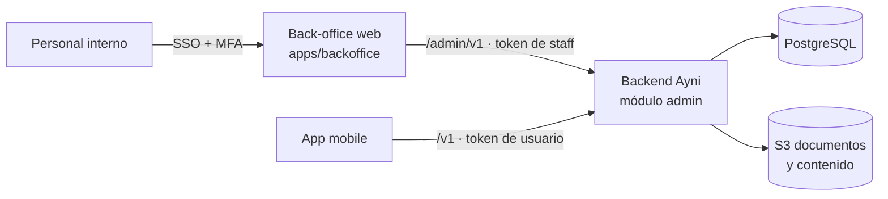

# Plan de implementación — Back-office de Ayni

Estado: **propuesta v2** (9 de noviembre de 2026), pendiente de aprobación del PO y del TL. Corresponde al pendiente **D13** de [pending-scope.md](pending-scope.md). Reemplaza la v1, que priorizaba el contenido de Home.

Convención: **[H]** hecho observado (código, Figma o docs), **[I]** inferencia técnica, **[?]** decisión pendiente. En este documento "círculo" es el término del dominio; la app lo muestra como **junta** ([ui-glossary.md](ui-glossary.md)).

## 1. Resumen

- **Qué es:** una aplicación web interna para operar Ayni: atender usuarios, revisar KYC, seguir los círculos, controlar el dinero y, más adelante, administrar contenido y reglas.
- **Por qué cambia la prioridad respecto de la v1:** para lanzar no falta contenido, falta **operación**. Hoy hay procesos del backend que exigen a una persona y no tienen dónde hacerse (§2).
- **MVP propuesto:** fases 1 a 3 (fundaciones, operación mínima y finanzas). Entre 55 y 89 story points, con confianza baja (§8).
- **Bloqueo principal:** elegir el proveedor de identidad del personal (BO2). Sin él, toda la API de administración responde 401.

## 2. Qué existe hoy

| Pieza                               | Estado [H]                                                                                                                                                                             |
| ----------------------------------- | -------------------------------------------------------------------------------------------------------------------------------------------------------------------------------------- |
| Autorización del personal           | `StaffGuard` y `@RequireStaff(rol, { stepUp })` en el backend, con roles `support`, `operations`, `finance`, `admin` y `super_admin`                                                   |
| Autenticación reforzada (step-up)   | Las acciones críticas exigen haberse autenticado hace menos de `STAFF_STEP_UP_MAX_AGE_SECONDS` (300 s)                                                                                 |
| Proveedor de identidad del personal | **En curso (fase 1):** `STAFF_AUTH_PROVIDER` admite `oidc` (Cognito u otro OIDC, validado con su JWKS) y `dev` (solo local). Falta crear el user pool (BO2) ([admin.md](api/admin.md)) |
| API de administración               | Solo `POST /admin/v1/circles/:id/pause` y `/resume` (COPAYNI-61), con rol `super_admin`, step-up y motivo                                                                              |
| Auditoría                           | `circle_admin_events`, de solo inserción, para pausas y reanudaciones                                                                                                                  |
| KYC sin proveedor                   | `KYC_PROVIDER=manual` deja cada documento **en revisión**; operaciones lo resuelve en la cola de KYC del back-office                                                                   |
| Fondo de garantía                   | Registro contable de doble entrada (COPAYNI-58). `RecordFundMovementUseCase` existe para el capital semilla y las correcciones, **sin endpoint**                                       |
| Ciclo mensual                       | La tarea diaria registra eventos (`circles.cycle.*`) solo en los logs. Los estados `approving` y `cancelled` (COPAYNI-62) no tienen vista para operaciones                             |
| Mora e impago                       | Gracia, expulsión, deuda con cargo por mora y bloqueo (COPAYNI-57), sin vista para el personal                                                                                         |
| Reglas de negocio                   | Siguen en variables de entorno: cambiar una regla exige un despliegue                                                                                                                  |

## 3. Alcance

### 3.1 Operación

| Módulo             | Funciones                                                                                                                                                      | Depende de     |
| ------------------ | -------------------------------------------------------------------------------------------------------------------------------------------------------------- | -------------- |
| Usuarios y soporte | Buscar por email o teléfono con PII enmascarada; ver perfil, círculos, documentos y pagos; revocar sesiones; bloquear o desbloquear; notas de soporte          | L3             |
| KYC                | Cola de documentos en revisión por antigüedad; ver el documento con URL prefirmada corta y acceso auditado; aprobar o rechazar con motivo; ajustar el límite   | T4, R5, L2, L5 |
| Círculos           | Listar por estado (`collecting`, `approving`, `contributing`, `paused`, `cancelled`, `finished`); detalle con miembros, turnos y calendario; pausar y reanudar | R2             |
| Ciclo mensual      | Ejecuciones de la tarea diaria, círculos que fallaron y propuestas de inicio vencidas                                                                          | COPAYNI-56, 62 |

### 3.2 Finanzas

| Módulo            | Funciones                                                                                                                              | Depende de |
| ----------------- | -------------------------------------------------------------------------------------------------------------------------------------- | ---------- |
| Fondo de garantía | Saldo y movimientos; registrar el capital semilla y las correcciones con motivo y doble aprobación                                     | R18, R21   |
| Cuotas y pozos    | Cuotas por estado (pendiente, vencida, pagada, descontada), cobros fallidos y pozos pagados o pendientes; conciliación con la pasarela | T3, T5     |
| Mora              | Miembros en gracia y expulsados, deuda con cargo por mora, devoluciones pendientes y retenciones del pozo                              | R3, R20    |

### 3.3 Reglas y contenido (después del MVP)

- **Parámetros de negocio versionados:** montos, duraciones, precio de turnos, gastos de administración, métodos de cobro, elegibilidad, mora, riesgo, referidos y cashback. Cada cambio crea una versión con vigencia, autor, motivo y aprobador; nunca altera condiciones ya congeladas (COPAYNI-55). La política de OTP, la base de datos, JWT y CORS **no** entran: se quedan en el pipeline.
- **Contenido de la app:** ofertas y metas de Home, banners, carrusel del paso 1, ayuda y FAQ, y documentos legales versionados con aceptación registrada.
- **Reglas comunes al contenido:** ciclo `borrador → programado → publicado → archivado`; textos por idioma; destinos de un tipo cerrado (nunca un deep link libre); validación contra las reglas vigentes al publicar.
- **Otros:** plantillas de notificaciones (D6), referidos y reportes.

## 4. Arquitectura

1. **API de administración dentro del backend actual [I].** Las reglas ya viven ahí; un servicio aparte las duplicaría. Los controladores `/admin/v1` reutilizan los casos de uso existentes, como ya hace la pausa.
2. **Front en el monorepo, en `apps/backoffice`.** Decidido el 9 de noviembre de 2026: el front valida las respuestas de `/admin/v1`, así que un cambio de contrato toca backend y front en el mismo PR. SPA en TypeScript con React, Vite y TanStack Query, según la base técnica enterprise del front. Usa npm como el resto del monorepo (la base técnica propone pnpm; se revisará si el monorepo pasa a workspaces). Se publica como estático.
3. **Identidad del personal: Amazon Cognito recomendado [?].** Encaja con AWS (T1) y con SES y SNS si se eligen para el OTP. Un user pool solo para el personal, MFA obligatorio y grupos como roles. Alternativas: Microsoft Entra ID o Google Workspace, si la organización ya los usa. Se implementa como `CognitoStaffAuthenticator` sobre el puerto existente.
4. **Contrato tipado.** El backend publica OpenAPI y el back-office genera su cliente en CI: si el contrato cambia, el build falla.
5. **Exposición separada [?].** Recomendado: `/admin/*` por un ALB o listener interno, con acceso por VPN. Alternativa: el mismo ALB con una regla de WAF.

### Modelo de datos nuevo [I]

| Tabla                   | Para qué                                                                                      |
| ----------------------- | --------------------------------------------------------------------------------------------- |
| `staff_audit_log`       | Auditoría general de solo inserción: actor, acción, entidad, antes, después, IP y `requestId` |
| `staff_approvals`       | Doble aprobación: acción propuesta, quién la propone, quién la aprueba y cuándo vence         |
| `support_notes`         | Notas del personal por usuario                                                                |
| `business_parameters`   | Parámetros versionados (fase 4)                                                               |
| `content_items` y otros | Contenido, traducciones, ayuda y legales (fase 5)                                             |

`circle_admin_events` se mantiene; la auditoría general registra también la pausa para tener una sola vista. El personal y sus roles viven en el proveedor de identidad: el backend no guarda contraseñas del personal.

## 5. Roles y permisos

El código ya define 5 roles. Propuesta para el MVP, sin agregar roles hasta que haga falta **[?]**:

| Acción                                         | support | operations | finance | admin | super_admin |
| ---------------------------------------------- | :-----: | :--------: | :-----: | :---: | :---------: |
| Buscar usuarios y ver su detalle (enmascarado) |    ✓    |     ✓      |    ✓    |       |      ✓      |
| Revelar PII con motivo                         |         |     ✓      |         |       |      ✓      |
| Revocar sesiones, bloquear o desbloquear       |    ✓    |     ✓      |         |       |      ✓      |
| Revisar KYC y ajustar el límite                |         |     ✓      |         |       |      ✓      |
| Ver círculos y el ciclo mensual                |    ✓    |     ✓      |    ✓    |       |      ✓      |
| Pausar y reanudar círculos (step-up)           |         |            |         |       |      ✓      |
| Ver finanzas y conciliación                    |         |            |    ✓    |       |      ✓      |
| Proponer movimientos del fondo                 |         |            |    ✓    |       |      ✓      |
| Aprobar movimientos del fondo (otra persona)   |         |            |    ✓    |       |      ✓      |
| Gestionar el personal                          |         |            |         |   ✓   |             |

- `admin` gestiona el personal pero no opera.
- La v1 proponía roles de contenido (`content_editor`, `content_publisher`) y `kyc_reviewer`: se agregan cuando lleguen esas fases, si `operations` resulta demasiado amplio.
- Al menos 2 personas con `super_admin`. Ese rol tampoco aprueba lo que propuso.

## 6. Seguridad

- **Privilegio mínimo:** cada endpoint exige su rol. Nadie borra datos financieros: solo hay registros compensatorios.
- **PII enmascarada por defecto.** Revelar exige motivo y queda auditado (L3, Ley 29733).
- **Documentos de KYC:** solo con URLs prefirmadas de vida corta. La retención sigue a L5.
- **Step-up:** obligatorio para pausar, reanudar, desbloquear, revelar PII y aprobar movimientos de dinero.
- **Web:** CSP estricta, tokens en memoria con PKCE, rate limit propio para `/admin` y expiración por inactividad.
- **Alertas:** muchos rechazos de autorización, revelados de PII sobre un umbral o movimientos del fondo fuera de horario. Los umbrales los define negocio **[?]**.

## 7. Plan por fases

| Fase | Entregable                                                                                                                                                                                            | Desbloquea                                       | Depende de                       |
| ---- | ----------------------------------------------------------------------------------------------------------------------------------------------------------------------------------------------------- | ------------------------------------------------ | -------------------------------- |
| 0    | Cerrar BO1–BO9                                                                                                                                                                                        | Todo                                             | PO, TL, UX                       |
| 1    | **Fundaciones:** proveedor de identidad y `CognitoStaffAuthenticator`; front en `apps/backoffice` con CI, lint, pruebas y contrato validado; login con MFA; `staff_audit_log`; exposición de `/admin` | Fases 2 a 6; la pausa deja de ser solo API       | BO2, BO8; pipeline de despliegue |
| 2    | **Operación mínima:** usuarios y soporte, cola de KYC, círculos (incluida la pausa ya existente) y ejecuciones del ciclo mensual                                                                      | Lanzar con `KYC_PROVIDER=manual`; soporte básico | Fase 1; L2, L5                   |
| 3    | **Finanzas:** fondo de garantía con capital semilla y doble aprobación, cuotas y pozos, cobros fallidos, mora y devoluciones                                                                          | Encender el scheduler con control; R18, R21      | Fase 1; T3; riel de pozos (T5)   |
| 4    | **Parámetros de negocio** versionados, con vista previa y doble aprobación                                                                                                                            | Cambiar reglas sin despliegue; R1, R4, R5        | Fase 1                           |
| 5    | **Contenido:** ofertas y metas de Home, banners, carrusel, ayuda y legales; `GET /v1/home/content` y secciones en la app                                                                              | Resto de COPAYNI-25; D7, D16, L4                 | Fase 1; BO4, BO5                 |
| 6    | **Notificaciones, referidos y reportes**                                                                                                                                                              | D6, E7                                           | T7, R7                           |

**Endpoints de la fase 2 [I]** (nombres provisionales):

- **[H] Implementado:** `GET /admin/v1/users?query=` (búsqueda exacta) y `GET /admin/v1/users/:id` ([admin.md](api/admin.md#búsqueda-de-personas))
- `POST /admin/v1/users/:id/sessions/revoke`, `POST /admin/v1/users/:id/block` y `/unblock`
- `POST /admin/v1/users/:id/pii/reveal` (motivo, step-up)
- **[H] Implementado:** `GET /admin/v1/kyc/reviews`, `GET /admin/v1/kyc/reviews/:id` y `GET /admin/v1/kyc/reviews/:id/pages/:page/url`
- **[H] Implementado:** `POST /admin/v1/kyc/reviews/:id/approve` y `/reject` (motivo de un catálogo; [admin.md](api/admin.md#revisión-manual-del-kyc))
- `GET /admin/v1/circles?state=` y `GET /admin/v1/circles/:id`
- `GET /admin/v1/cycle-runs` (requiere guardar las ejecuciones, hoy solo en logs)

**Endpoints de la fase 3 [I]:**

- **[H] Implementado, solo lectura:** `GET /admin/v1/finance/installments`, `/payouts` y `/guarantee-fund` ([admin.md](api/admin.md#finanzas-solo-lectura)). Lo que mueve dinero sigue pendiente de BO6
- `POST /admin/v1/guarantee-fund/movements` (propone) y `POST /admin/v1/approvals/:id/approve`
- `GET /admin/v1/installments?status=`, `GET /admin/v1/payouts?status=`
- `GET /admin/v1/delinquency` (en gracia, expulsados, deudas y devoluciones)

## 8. Estimación preliminar

Story points relativos al backlog actual. **Confianza baja:** no hay diseño del back-office ni velocidad histórica del equipo. No deben convertirse en horas ni fechas.

| Fase                                   | SP (rango) | Notas                                                           |
| -------------------------------------- | ---------- | --------------------------------------------------------------- |
| 1 Fundaciones                          | 21–34      | Lo más incierto: proveedor de identidad e infraestructura       |
| 2 Operación mínima                     | 21–34      | La pausa y el guard ya existen; KYC exige revisión de seguridad |
| 3 Finanzas                             | 13–21      | El registro contable y su caso de uso ya existen                |
| **MVP (1–3)**                          | **55–89**  |                                                                 |
| 4 Parámetros de negocio                | 13–21      |                                                                 |
| 5 Contenido                            | 21–34      | Incluye el endpoint público y las secciones en mobile           |
| 6 Notificaciones, referidos y reportes | 21–34      | Sujeto a D6, T7 y R7                                            |

## 9. Pruebas

- **Backend:** pruebas unitarias, de integración contra PostgreSQL y e2e de cada endpoint `/admin`, con los patrones del repositorio. Cada endpoint rechaza a los roles que no corresponden y exige step-up donde aplica.
- **Front:** pruebas de componentes y e2e (por ejemplo Playwright) de los flujos de revisión de KYC y de doble aprobación.
- **Contrato:** el cliente generado desde OpenAPI rompe el build si el contrato cambia.
- **Seguridad:** revisión antes de exponer PII o documentos (fase 2).

## 10. Riesgos

| Riesgo                                                                                     | Mitigación                                                            |
| ------------------------------------------------------------------------------------------ | --------------------------------------------------------------------- |
| Lanzar con `KYC_PROVIDER=manual` sin cola de revisión deja a los usuarios sin poder unirse | La cola de KYC entra en la fase 2, antes del lanzamiento              |
| Un error del personal mueve dinero                                                         | Doble aprobación, motivo obligatorio y solo registros compensatorios  |
| Exposición de PII o documentos                                                             | Enmascarado por defecto, revelado auditado, URLs cortas y red interna |
| El front depende de un pipeline de despliegue que todavía no existe                        | La fase 1 comparte el trabajo del pipeline de la API                  |
| Las reglas sin definir (R1, R4, R5) cambian después de construir la fase 4                 | La fase 4 va después del MVP; los parámetros se versionan             |

## 11. Decisiones pendientes

| #   | Pregunta                                                                                         | Responsable |
| --- | ------------------------------------------------------------------------------------------------ | ----------- |
| BO1 | ¿Back-office propio para todo, o CMS headless solo para ayuda y legales?                         | PO / TL     |
| BO2 | Proveedor de identidad del personal y política de MFA (recomendado: Cognito con MFA obligatorio) | TL          |
| BO3 | Confirmar la matriz de roles de §5                                                               | PO / Legal  |
| BO4 | Campos de "Popular Goals" y "Latest Offers" (Figma `55:8637`)                                    | UX          |
| BO5 | ¿Las ofertas se segmentan por usuario?                                                           | PO          |
| BO6 | ¿Qué acciones requieren doble aprobación y quién aprueba?                                        | PO / Legal  |
| BO7 | Diseño UX del back-office (no existe en el Figma)                                                | UX          |
| BO8 | Exposición de `/admin`: ALB interno con VPN o WAF en el ALB público                              | TL          |
| BO9 | Stack del front (propuesto: React, Vite, TanStack Query y una librería de administración)        | TL          |

## 12. Siguiente paso

1. Revisar este plan con el PO y el TL, y cerrar BO2, BO3, BO8 y BO9, que bloquean la fase 1.
2. Crear en Jira una épica de back-office con las fases 1 a 3 como historias. **Pendiente de aprobación; no se crea nada todavía.**
3. Si UX diseña el back-office en Figma, analizarlo antes de la fase 2.
